# SCP Foundation — Ouroboros для RimWorld

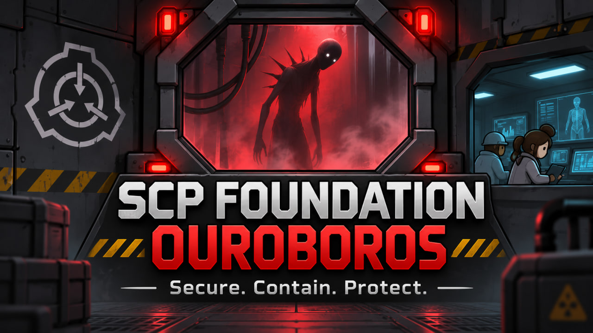

Бесплатный любительский мод для RimWorld 1.6 и 1.7 о содержании и исследовании SCP. Колония устанавливает связь с Фондом, принимает аномальные объекты, строит для них камеры, ведёт наблюдение и постепенно раскрывает сюжетную линию «Уроборос». Автор мода — Zokl17. Это неофициальный проект, не связанный с SCP Wiki или Ludeon Studios.

## Как начать

1. Изучите ванильные «Основы микроэлектроники», затем проект «Связь с Фондом» на вкладке исследований мода.
2. Постройте и запитайте терминал Фонда. Через него доступны переписка, поручения, архив и сведения об объектах.
3. После знакомства с Фондом подготовьте первый пост содержания и выполняйте его поручения. У каждого SCP свои требования к камере, персоналу и исследованиям.

События развиваются во время обычной игры: новые объекты и задания приходят постепенно. Для части действий требуется изучить сам объект или аттестовать сотрудника. Нарушение условий содержания может привести к побегу и потребовать помощи вооружённых отрядов.

## Установка

1. Распакуйте архив так, чтобы папка мода содержала `About/About.xml`, `Defs`, `Textures` и папки `1.6/Assemblies` и `1.7/Assemblies`. Игра автоматически выберет сборку для своей версии.
2. Включите мод в меню RimWorld 1.6 или 1.7 и перезапустите игру. Для основной игры нужны Core и отдельно установленная Harmony: https://github.com/pardeike/HarmonyRimWorld/releases/latest. Включите Harmony выше Core; DLL библиотеки в этот мод не включена.
3. Начните в новой колонии либо загрузите сохранение после создания его резервной копии. Сюжет начинается после контакта с Фондом и включения терминала связи.

Некоторые задания и возможности используют DLC, если оно установлено. Combat Extended не обязателен: его патчи подключаются только при активном CE. Полный оружейный адаптер CE поставляется для RimWorld 1.6; для 1.7 есть отдельный ограниченный патч SCP-882, но полноценная совместимость оружия с CE 1.7 пока не проверена. При включённом CE в 1.6 зуб SCP-127 наносит 120 урона с пробитием 270 без поджога; оружейная мастерская принимает оружие CE. Подствольные способности Odyssey для CE-оружия пока недоступны.

## Что внутри

- Аномалии с разными требованиями к содержанию, экспериментами и досье.
- Фракции Фонда, Повстанцев Хаоса, Глобальной оккультной коалиции и Церкви Разбитого Бога.
- Оборудование и исследования Фонда, задания на мировых картах, архив и переписка в терминале.
- Законченная в моде цепочка «Уробороса»: оборона SCP-882, встреча с O5-7, ретранслятор, тайник Церкви, изучение деталей SCP-629, утраченный журнал и финальное заключение. SCP-096 — самостоятельное задание.

Коллекция включает опасные и полезные объекты: SCP-458 даёт пиццу, SCP-330 — конфеты, а SCP-079 требует изоляции от сети и допускает только ручную запись бесед. Для SCP-914 предусмотрены перенос, изучение и переработка подходящих предметов. Исследования открывают посты, оборудование, одежду и оружие Фонда; отряды других организаций могут вмешиваться в дела колонии.

## Скриншоты

Немало SCP-предметов ждут изучения и собственных условий содержания.

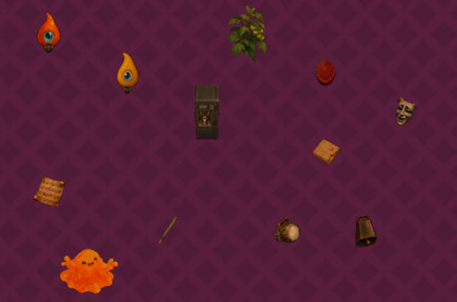

Некоторые аномалии могут оказаться полезными для колонии: например, SCP-458 и SCP-330.

| SCP-458: пицца | SCP-330: конфеты |
| --- | --- |
| 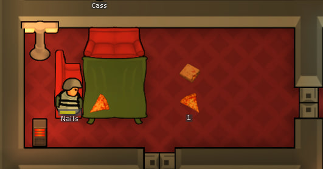 | 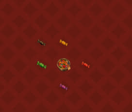 |

Знакомые объекты тоже здесь: SCP-049, SCP-173, SCP-106 и другие.

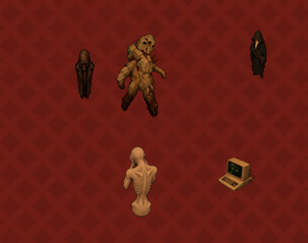

Фонд не единственная сила на планете. Встречаются Глобальная оккультная коалиция, Церковь Разбитого Бога, Повстанцы Хаоса и отряды МОГ.

| Глобальная оккультная коалиция | Церковь Разбитого Бога | Повстанцы Хаоса и МОГ |
| --- | --- | --- |
| 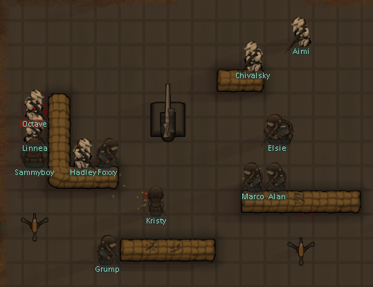 | 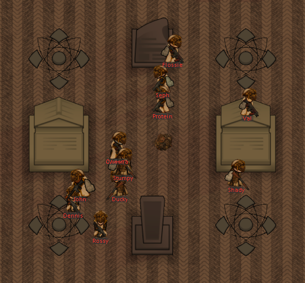 | 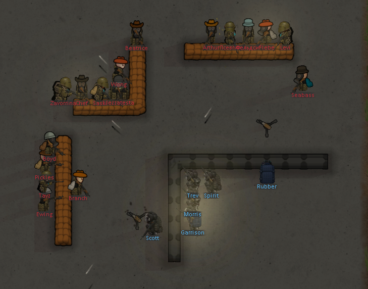 |

Содержание иногда нарушается, и тогда колонии приходится защищаться.

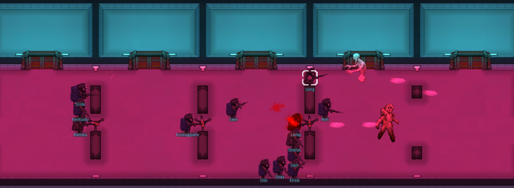

В крупных столкновениях Фонд может задействовать «Авангард».

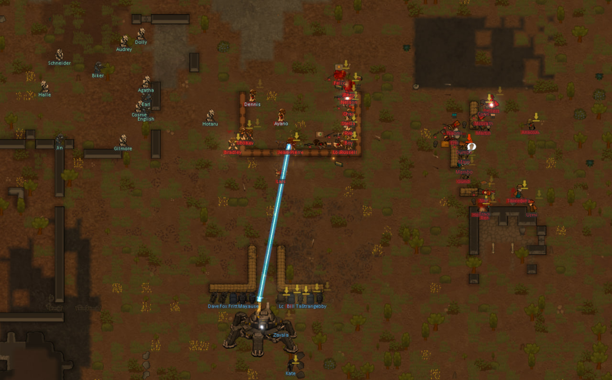

А в закрытых грузах Фонда могут ждать другие открытия.

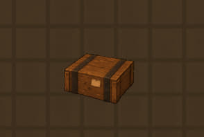

Список SCP в моде — содержит спойлеры

SCP-008, SCP-012, SCP-035, SCP-049, SCP-055, SCP-067, SCP-076-2, SCP-079, SCP-093, SCP-096, SCP-106, SCP-127, SCP-131, SCP-173, SCP-207, SCP-262, SCP-294, SCP-316, SCP-330, SCP-354, SCP-427, SCP-458, SCP-500, SCP-504, SCP-513, SCP-650, SCP-682, SCP-882, SCP-914, SCP-939 и SCP-999.

В сюжете также фигурируют SCP-001 («Уроборос»), SCP-217 и SCP-629. Их присутствие в истории не означает, что каждый из них можно получить как отдельный игровой объект.

## Лицензия и авторы

Уведомление, требуемое [лицензией RimWorld](https://store.steampowered.com/eula/294100_eula_1):

> Portions of the materials used to create this content/mod are trademarks and/or copyrighted works of Ludeon Studios Inc. All rights reserved by Ludeon. This content/mod is not official and is not endorsed by Ludeon.

Вселенная SCP Foundation и связанные материалы созданы авторами [SCP Wiki](https://scp-wiki.wikidot.com/) и распространяются на условиях [CC BY-SA 3.0](https://creativecommons.org/licenses/by-sa/3.0/). Мод является адаптацией: его тексты, механики, оформление и сюжетные дополнения, основанные на SCP, выпускаются на тех же условиях. Копировать и изменять их можно при указании авторов и источников, сохранении лицензии и обозначении изменений. Это не означает, что SCP Wiki или авторы статей одобряют мод.

Отправная точка сюжета — цикл [«Ouroboros»](https://scp-wiki.wikidot.com/ouroboros) авторов djkaktus и TwistedGears. **Полный список использованных статей, конкретных авторов, ссылок и игровых изменений находится в [CREDITS.md](CREDITS.md)**. Условия для файлов мода и сторонней библиотеки изложены в [LICENSE.md](LICENSE.md) и [HARMONY-LICENSE.txt](HARMONY-LICENSE.txt).

Объяснение происхождения сигнала SCP-882, персонажи колонии и последовательность заданий написаны для мода и не являются дословным каноном SCP Wiki. Релизный архив использует собственные геометрические эффекты «Авангарда» и звуки из установленной игры; скопированные ресурсы UF Heavy Industries и звук SCP-106 с неподтверждённым происхождением в него не входят.

## Сборка и ограничения

Сборка 1.6 проверена с RimWorld 1.6.4633 rev1260. Для 1.7.4990 rev1069 собрана отдельная DLL с Harmony 3; проверены загрузка типов и работа Harmony на .NET 10. Полное игровое тестирование ветки 1.7 продолжается. Внутриигровую проверку всех сюжетных переходов и сохранения/загрузки нельзя заменить автоматическими тестами. Если найдёте ошибку, приложите игровой лог, версию RimWorld и список активных модов.

Исходный код мода включён в архив в папке `Source`. Для разработки и подробных сценариев проверки см. документацию в исходном рабочем проекте.
